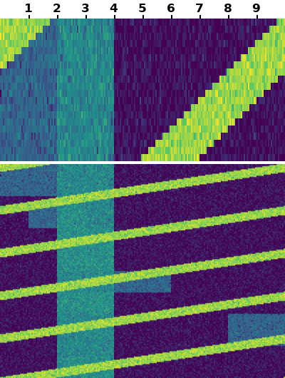

# SpecOne

Training and inference code for **SpecOne: A System-One Decision Model for Constraint-Aware Anti-Jamming** (paper under
review).

SpecOne reads a two-panel spectrum waterfall together with the link's text constraints (rate requirement, power
boost, switching cost, protected users) and answers typed questions: which channel to use in the next slot, then
which transmission mode on that channel. It is a System-One decision model: one forward pass gives a probability for
every option, and the answer is always one of the options. SpecOne is fine-tuned on the JamPivot benchmark from
[OneJev1.6-0.8B](https://huggingface.co/OmniJev/OneJev1.6-0.8B) and
[OneJev1.6-4B](https://huggingface.co/OmniJev/OneJev1.6-4B) with OneJev's trainer.

This repository holds the method of Sec. IV of the paper. The JamPivot generator, the baselines and the closed-loop
simulator are not included, and neither are the model weights.

| Paper | Code |
|---|---|
| IV-A Chained System-One scoring (channel, then mode on the model's own channel) | [`specone/score.py`](specone/score.py) |
| IV-B Utility-soft targets, τ = 0.05 | [`specone/targets.py`](specone/targets.py) |
| IV-B Loss: cross-entropy + Brier (β = 1), option order permuted, all weights trained | OneJev `train/sft.py` with [`configs/specone.yaml`](configs/specone.yaml) |
| IV-C Contrast-pair training set | [`specone/build_train.py`](specone/build_train.py) |
| IV-D Selective decisions: risk–coverage curve, AURC | [`specone/selective.py`](specone/selective.py) |
| IV-D Certified gate (SGR with Clopper–Pearson bounds) | [`specone/gate.py`](specone/gate.py) |
| V Channel / mode / joint accuracy, regret, ECE, pair accuracy | [`specone/metrics.py`](specone/metrics.py) |
| V Per-decision latency | [`specone/latency.py`](specone/latency.py) |

## Setup

```bash
git clone https://github.com/OmniJev/OneJev.git
git -C OneJev checkout 0b9e163f8114f94a40598c59b0bac473ff446f3c
git -C OneJev apply ../SpecOne/patches/onejev-speed.patch   # optional, needed only for the 4B speed flags
pip install -r requirements.txt
export ONEJEV=$PWD/OneJev
```

Download the base models from Hugging Face (`OmniJev/OneJev1.6-0.8B`, `OmniJev/OneJev1.6-4B`).
[`patches/onejev-speed.patch`](patches/onejev-speed.patch) adds speed and memory options to OneJev's trainer
(`--fwd-split`, `--attn-impl`, `--prefetch-workers`, `--prefetch-timeout`, `--tf32`, `--save-epochs`). None of them
changes the loss, the data order or the gradient.

Tested with Python 3.12, PyTorch 2.11 (CUDA 13.0), transformers 5.9.0, flash-linear-attention 0.5.2 and
causal-conv1d 1.6.1 (see [`requirements.txt`](requirements.txt)).

## Data

The scripts read a JamPivot folder `DATA`:

```
DATA/
  rows_<split>.jsonl     one row per question (chan, mode, feas, type) in OneJev's row format
  scenes_<split>.jsonl   one record per scene with the oracle utility table U (9 channels x 5 modes)
  pairs_<split>.jsonl    contrast pairs of the pair splits
  media/<split>/*.png    the two-panel waterfalls (400 x 530)
```

Splits: `train`, `pair_train`, `test_id`, `ood_combo`, `ood_style`, `pair_test`.
[`examples/`](examples) has one scene of `test_id`: its waterfall, its channel and mode rows, its scene record, and a
pair record. Each row stores `target` (uniform over the optimal set) and `target_soft` (utility-soft, τ = 0.05).
Training mode rows carry the teacher channel in `state["chosen channel"]` (the current channel if optimal, else the
first optimal one); at test time `score.py` replaces it with the model's own choice.



## Training

Build the training set (39,400 scenes, of which 15,994 are the two scenes of 7,997 training contrast pairs) and the
monitoring set:

```bash
python specone/build_train.py $DATA        # writes $DATA/train_softpairs.jsonl and $DATA/dev.jsonl
```

Train:

```bash
# SpecOne-0.8B
ONEJEV=$ONEJEV DATA=$DATA scripts/train.sh /path/to/OneJev1.6-0.8B specone_0.8b
# SpecOne-4B (with the patch)
ONEJEV=$ONEJEV DATA=$DATA scripts/train.sh /path/to/OneJev1.6-4B specone_4b \
  --fwd-split 2 --attn-impl flash_attention_2 --prefetch-workers 2 --tf32
```

Recipe ([`configs/specone.yaml`](configs/specone.yaml)): full fine-tune including the vision tower, fp32 master weights
with bf16 autocast, AdamW, lr 1e-5 with 3% warmup, 2 epochs, 64 rows per optimizer step, 32,768 tokens per forward
pass, Brier weight 1.0. In the paper both sizes were trained on one RTX PRO 6000 (96 GB): 3.5 h for 0.8B and 8.2 h
for 4B (peak memory 83 GiB with `--fwd-split 2`). On a 24 GB GPU, add `--batch-tokens 16384` for the 0.8B model;
the optimizer step still sums 64 rows.

## Inference and evaluation

```bash
export PYTHONPATH=$ONEJEV
# chained scoring: channel rows first, then each mode row re-asked on the model's chosen channel
python specone/score.py --model runs/specone_0.8b/final --data $DATA --split test_id --out preds/specone_test_id.jsonl
python specone/metrics.py --data $DATA --split test_id --preds preds/specone_test_id.jsonl
# risk-coverage curve and AURC of kappa = p(channel) x p(mode | channel)
python specone/selective.py --data $DATA --split test_id --preds specone=preds/specone_test_id.jsonl --out sel.json
# certified gate: thresholds fitted on the even scenes of test_id, applied to the odd ones and to other splits
python specone/gate.py --data $DATA --preds preds/specone_test_id.jsonl --alpha 0.05 0.10 --delta 0.05 \
  --apply ood_combo=preds/specone_ood_combo.jsonl
```

[`scripts/evaluate.sh`](scripts/evaluate.sh) runs all of this on the four test splits.

## License

See [LICENSE](LICENSE). OneJev, its trainer and the OneJev1.6 base models are Apache-2.0;
`patches/onejev-speed.patch` modifies OneJev's `train/sft.py` and `train/common.py`.
