<div align="center">

<h1>SpecOne: A System-One Decision Model for Constraint-Aware Anti-Jamming</h1>

<a href="#citation"></a>
<a href="https://huggingface.co/datasets/danzonghao/JamPivot"></a>
<a href="https://huggingface.co/OmniJev/OneJev1.6-0.8B"></a>
<a href="https://huggingface.co/OmniJev/OneJev1.6-4B"></a>
<a href="LICENSE"></a>


</div>

<p align="center">
  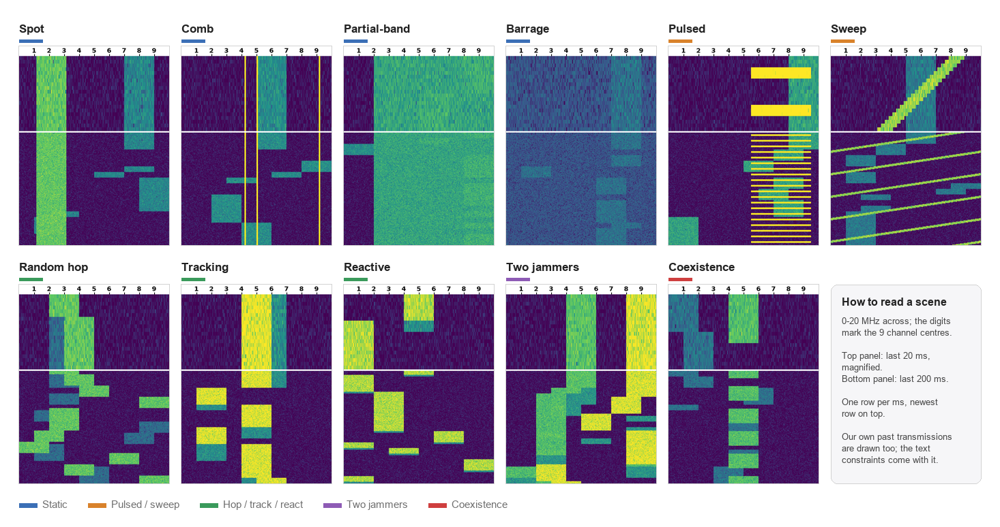
</p>

<p align="center">
<b>Eleven interferer categories, one test scene each.</b> A radio link has to pick its next channel and transmission
mode from a waterfall like these, under constraints that the waterfall does not show. SpecOne reads the waterfall and
the constraints as text, answers typed questions whose options are executable actions, and scores every option in one
forward pass.
</p>

## News

- **`2026-10-29`** The JamPivot benchmark is on Hugging Face: [danzonghao/JamPivot](https://huggingface.co/datasets/danzonghao/JamPivot).
- **`2026-10-29`** Training and inference code released.

## Contents

1. [Highlights](#highlights)
2. [Interference gallery](#interference-gallery)
3. [Method](#method)
4. [The JamPivot benchmark](#the-jampivot-benchmark)
5. [Results](#results)
6. [Getting started](#getting-started): [setup](#setup) · [data](#data) · [training](#training) · [inference and evaluation](#inference-and-evaluation)
7. [Citation](#citation) · [Acknowledgements](#acknowledgements) · [License](#license)

## Highlights

- :dart: **Typed, executable decisions.** Each decision is a chain of typed questions: which channel for the next slot,
  then which mode on that channel. The probability of every option comes from one forward pass, and the answer is
  always one of the options, so the radio can execute it as it is.
- :memo: **Constraints as text.** The rate floor, the power budget, the switching cost and the protected users differ
  between deployments and never appear in the waterfall. SpecOne reads them as text, so a new constraint needs no new
  reward or retraining.
- :balance_scale: **Utility-soft targets and contrast pairs.** Training targets follow the radio's own utility, and
  7,997 contrast pairs teach the model the details that change the best action.
- :shield: **Certified selective decisions.** The product of the channel and mode probabilities gates each slot; a
  threshold certified with Clopper–Pearson bounds lets SpecOne-0.8B act on 41% and 84% of held-out slots at error
  targets of 5% and 10%, with errors of 3.6% and 7.3%.
- :trophy: **Results.** 91.6% (0.8B) and 91.7% (4B) optimal joint decisions, against 87.8% for a generative
  Qwen3.5-0.8B trained on the same questions; in a closed loop where the jammers react to its moves, 92.5% and 94.5%
  of the oracle's utility, +5.8% and +8.1% over an online-trained DQN.

## Interference gallery

JamPivot extends the four jammers of Liu et al. (sweep, comb, random hop and an intelligent tracker) with the spot,
partial-band, barrage, pulsed and reactive jammers, two-jammer mixes and protected users. Four test scenes per
category, with the parameters drawn for each (J/S per bin, relative to our signal):

<table>
  <tr><th width="26%">Category</th><th>Four test scenes</th></tr>
  <tr><td>🟦 <b>Spot</b><br><sub>2/4/6 MHz block, −5..15 dB.<br>Favours a clean channel, or a gain mode.</sub></td>
      <td>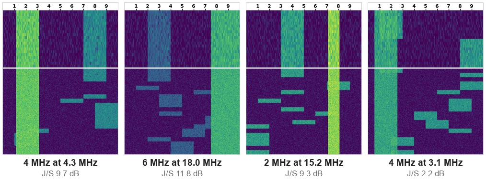</td></tr>
  <tr><td>🟦 <b>Comb</b><br><sub>3–5 narrow tones, 8..25 dB.<br>Favours a channel free of tones.</sub></td>
      <td>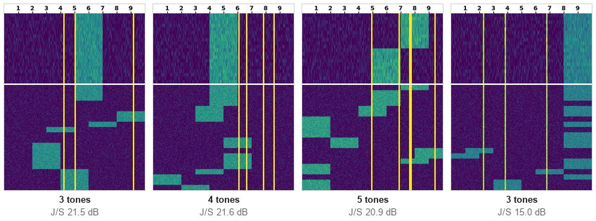</td></tr>
  <tr><td>🟦 <b>Partial-band</b><br><sub>Fixed 8–16 MHz noise, −10..8 dB.<br>Favours a channel outside it, or spreading.</sub></td>
      <td>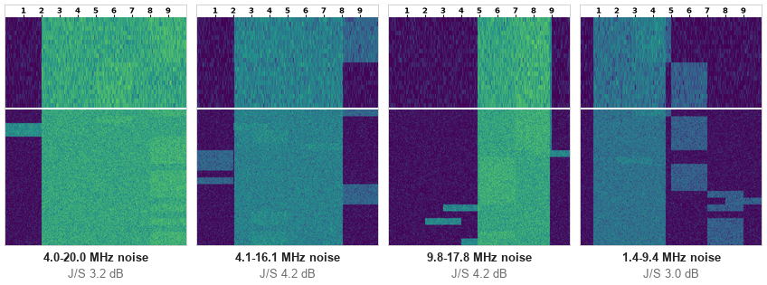</td></tr>
  <tr><td>🟦 <b>Barrage</b><br><sub>Whole band, −12..6 dB.<br>Only the mode matters; often infeasible.</sub></td>
      <td>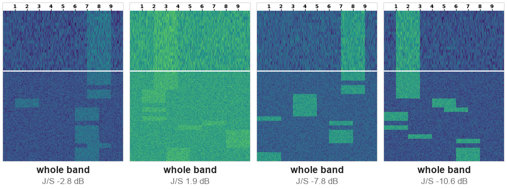</td></tr>
  <tr><td>🟧 <b>Pulsed</b><br><sub>4–12 MHz on/off, period 5–16 ms.<br>Avoid its band, or time it by its phase.</sub></td>
      <td>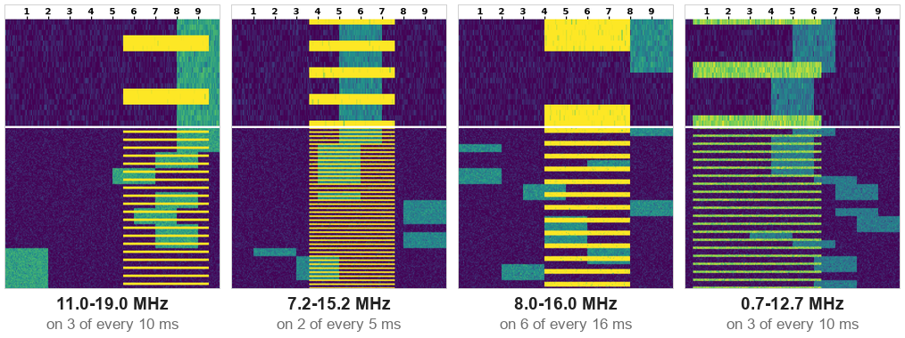</td></tr>
  <tr><td>🟧 <b>Sweep</b><br><sub>2/4 MHz, 0.5/1 GHz/s, −5..20 dB.<br>Favours a channel it will miss in the next 10 ms.</sub></td>
      <td>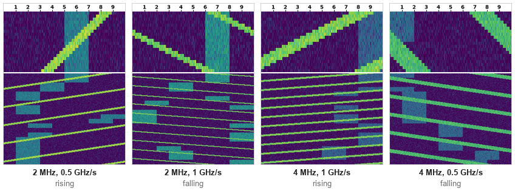</td></tr>
  <tr><td>🟩 <b>Random hop</b><br><sub>New channel every 10/20/30 ms.<br>Decide on the mean over the next hops.</sub></td>
      <td>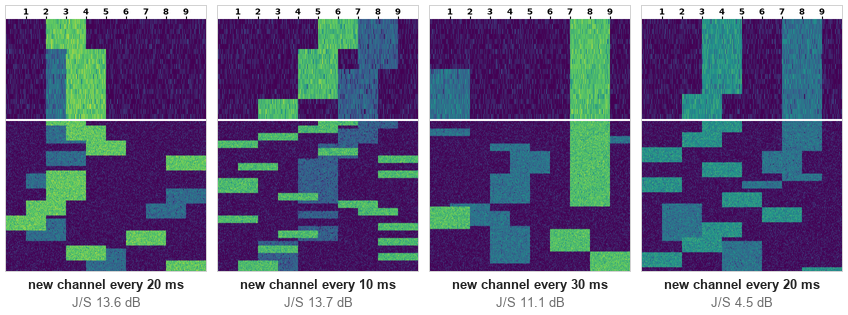</td></tr>
  <tr><td>🟩 <b>Tracking</b><br><sub>Jams our most-used channel of the last 100 ms.<br>Any channel but its target.</sub></td>
      <td>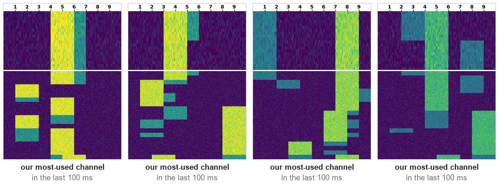</td></tr>
  <tr><td>🟩 <b>Reactive</b><br><sub>Jams our channel 2–5 ms after we send.<br>No escape; often infeasible.</sub></td>
      <td>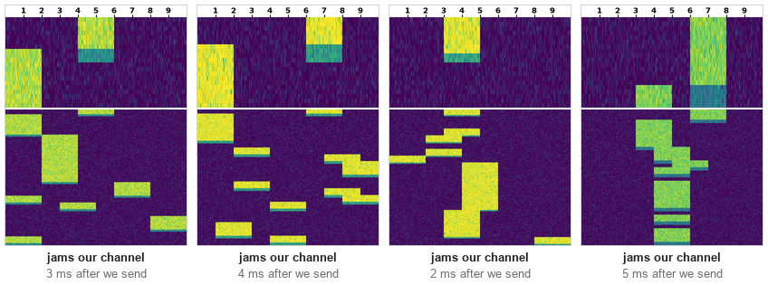</td></tr>
  <tr><td>🟪 <b>Two jammers</b><br><sub>Two of spot, comb, pulsed, sweep, hop, tracking; three of the fifteen pairs occur only in testing.<br>Both laws at once.</sub></td>
      <td>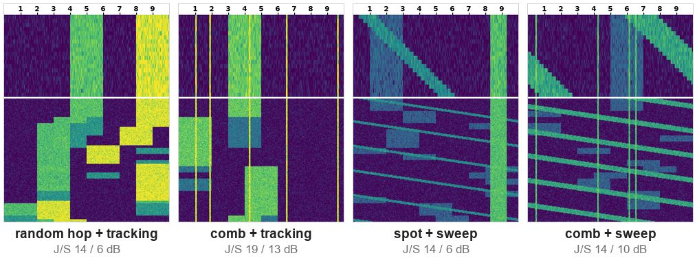</td></tr>
  <tr><td>🟥 <b>Coexistence</b><br><sub>1–2 periodic or Markov protected users, half with a jammer.<br>No overlap with an active user or its guard band.</sub></td>
      <td>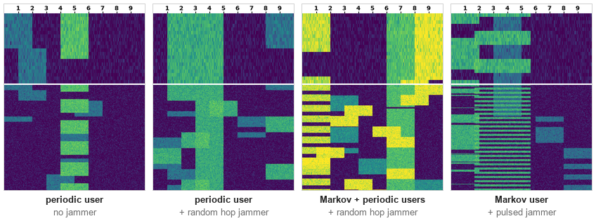</td></tr>
</table>

<sub>Each image: 0–20 MHz across, the digits mark the nine overlapping 4 MHz channels; top panel the last 20 ms
magnified, bottom panel the last 200 ms, newest row on top. Our own past transmissions are drawn too.</sub>

## Method

<p align="center">
  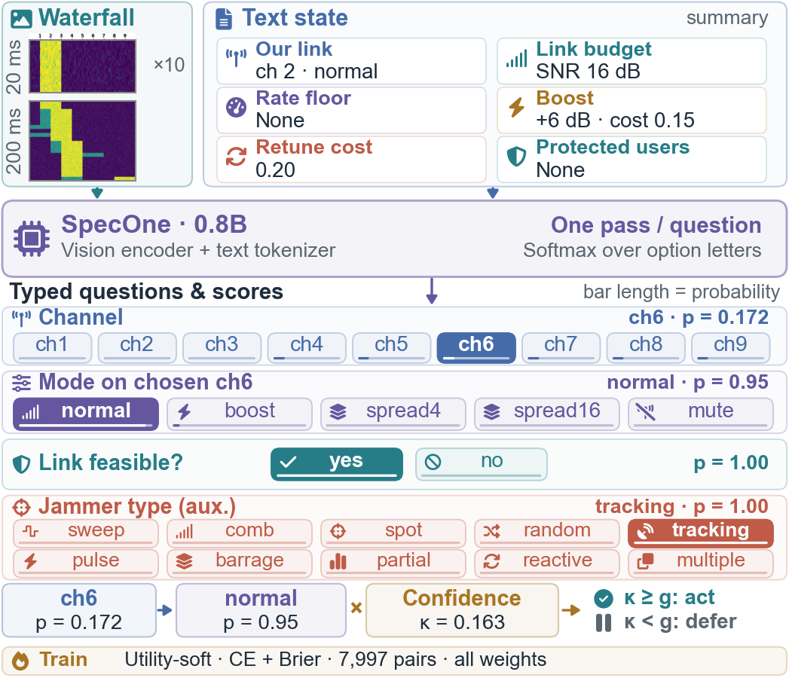
</p>

<p align="center"><sub>SpecOne on a tracking-jammer test scene: each typed question scores all its options in one
forward pass, and thin bars give their probabilities. Channels 4–9 are optimal; the model picks channel 6, then normal
mode, and acts only if κ = 0.163 reaches the threshold g. The bottom strip summarizes training.</sub></p>

SpecOne is OneJev1.6-0.8B or OneJev1.6-4B fine-tuned on JamPivot. The vision encoder turns the two-panel waterfall into
image tokens, the tokenizer turns the text state and the question with its lettered options into text tokens, and the
probability of each option is the softmax of the option-letter logits at the last prompt position.

| Paper | Code |
|---|---|
| IV-A Chained System-One scoring (channel, then mode on the model's own channel) | [`specone/score.py`](specone/score.py) |
| IV-B Utility-soft targets, τ = 0.05 | [`specone/targets.py`](specone/targets.py) |
| IV-B Loss: cross-entropy + Brier (β = 1), option order permuted, all weights trained | OneJev `train/sft.py` with [`configs/specone.yaml`](configs/specone.yaml) |
| IV-C Contrast-pair training set | [`specone/build_train.py`](specone/build_train.py) |
| IV-D Selective decisions: risk–coverage curve, AURC | [`specone/selective.py`](specone/selective.py) |
| IV-D Certified gate (SGR with Clopper–Pearson bounds) | [`specone/gate.py`](specone/gate.py) |
| V Channel / mode / joint accuracy, regret, ECE, pair accuracy | [`specone/metrics.py`](specone/metrics.py) |
| V Per-decision latency | [`specone/latency.py`](specone/latency.py) |

## The JamPivot benchmark

<p align="center">
  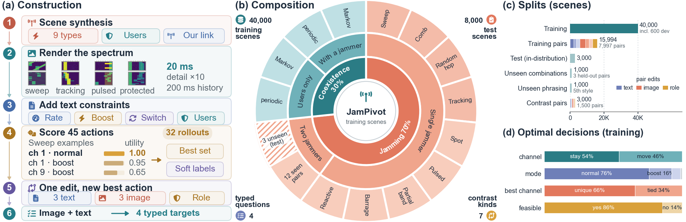
</p>

48,000 scenes, each a waterfall image with text constraints and four typed questions (channel, mode, feasibility and
the auxiliary jammer type). Every scene is labelled by the one-step Bayes oracle: the expected utility of all 45
channel–mode actions over the next slot under the known interferer laws, with random hops and Markov users averaged
over 32 rollouts. The test side holds an in-distribution split, three
unseen jammer pairs, an unseen phrasing of the constraints, and 1,500 contrast pairs in which one edit of the text, the
image or the role changes the best action. The data is on Hugging Face at
[danzonghao/JamPivot](https://huggingface.co/datasets/danzonghao/JamPivot) (CC BY 4.0); the generator is not part of
this repository.

## Results

Offline decisions on JamPivot (%, regret in units of the normal rate) and the closed loop (mean utility per slot,
jammers reacting to the link's moves). ‡ trained on JamPivot. OneJev1.6-0.8B is zero-shot; the online DQN is trained
for 2×10⁶ slots in the JamPivot simulator; the oracle takes the one-step Bayes action, knowing the interferers' laws.

| Method | Joint ↑ | Regret ↓ | Unseen jammers ↑ | Unseen phrasing ↑ | Pairs solved ↑ | Closed loop ↑ |
|---|:-:|:-:|:-:|:-:|:-:|:-:|
| OneJev1.6-0.8B | 31.0 | 0.440 | 24.6 | 22.9 | 0.8 | – |
| DQN-A ‡ | 62.2 | 0.137 | 58.6 | 59.1 | 19.5 | 0.611 |
| Online DQN (Liu et al.) | – | – | – | – | – | 0.642 |
| ResNet-18 ‡ | 74.8 | 0.104 | 69.4 | 74.5 | 35.0 | 0.635 |
| DINOv2 ViT-L ‡ | 81.5 | 0.067 | 76.1 | 80.6 | 42.6 | 0.662 |
| Qwen3.5-0.8B, generative ‡ | 87.8 | 0.036 | 79.1 | 87.1 | 62.6 | – |
| **SpecOne-0.8B** ‡ | 91.6 | **0.027** | 84.9 | 90.3 | 81.1 | 0.679 |
| **SpecOne-4B** ‡ | **91.7** | 0.030 | **86.3** | **91.6** | **82.5** | **0.694** |
| Oracle | – | – | – | – | – | 0.734 |

| Model | Base | Training | Weights |
|---|---|---|---|
| SpecOne-0.8B | [OneJev1.6-0.8B](https://huggingface.co/OmniJev/OneJev1.6-0.8B) | 3.5 h on one RTX PRO 6000 | not included |
| SpecOne-4B | [OneJev1.6-4B](https://huggingface.co/OmniJev/OneJev1.6-4B) | 8.2 h on one RTX PRO 6000 | not included |

## Getting started

### Setup

```bash
git clone https://github.com/dan-zong-hao/SpecOne.git
git clone https://github.com/OmniJev/OneJev.git
git -C OneJev checkout 0b9e163f8114f94a40598c59b0bac473ff446f3c
git -C OneJev apply ../SpecOne/patches/onejev-speed.patch   # optional: only for the 4B speed flags
cd SpecOne && pip install -r requirements.txt
export ONEJEV=$PWD/../OneJev
```

Download the base models from Hugging Face (`OmniJev/OneJev1.6-0.8B`, `OmniJev/OneJev1.6-4B`).
[`patches/onejev-speed.patch`](patches/onejev-speed.patch) adds speed and memory options to OneJev's trainer
(`--fwd-split`, `--attn-impl`, `--prefetch-workers`, `--prefetch-timeout`, `--tf32`, `--save-epochs`); none of them
changes the loss, the data order or the gradient. Tested with Python 3.12, PyTorch 2.11 (CUDA 13.0), transformers 5.9.0,
flash-linear-attention 0.5.2 and causal-conv1d 1.6.1.

### Data

Download JamPivot from [Hugging Face](https://huggingface.co/datasets/danzonghao/JamPivot) (10.7 GB) and unpack the
waterfalls from its WebDataset shards:

```bash
hf download danzonghao/JamPivot --repo-type dataset --local-dir JamPivot
cd JamPivot
for f in data/*/*.tar; do s=$(basename "$(dirname "$f")"); mkdir -p media/$s; tar -xf "$f" -C media/$s --wildcards '*.png'; done
export DATA=$PWD
```

The scripts read this folder `DATA`:

```
DATA/
  rows_<split>.jsonl     one row per question (chan, mode, feas, type) in OneJev's row format
  scenes_<split>.jsonl   one record per scene with the oracle utility table U (9 channels x 5 modes)
  pairs_<split>.jsonl    contrast pairs of the pair splits
  media/<split>/*.png    the two-panel waterfalls (400 x 530)
  train_softpairs.jsonl, dev.jsonl   the training and monitoring files, as specone/build_train.py writes them
```

<details>
<summary>Row format and an example scene</summary>

Splits: `train`, `pair_train`, `test_id`, `ood_combo`, `ood_style`, `pair_test`. [`examples/`](examples) has one scene
of `test_id`: its waterfall, its [channel row](examples/row_chan.json), its [mode row](examples/row_mode.json), its
[scene record](examples/scene.json) and a [pair record](examples/pair.json). Each row stores `target` (uniform over the
optimal set) and `target_soft` (utility-soft, τ = 0.05). Training mode rows carry the teacher channel in
`state["chosen channel"]` (the current channel if it is optimal, else the first optimal one); at test time `score.py`
replaces it with the model's own choice.

</details>

### Training

```bash
python specone/build_train.py $DATA        # writes $DATA/train_softpairs.jsonl and $DATA/dev.jsonl (the download already has them)

# SpecOne-0.8B
ONEJEV=$ONEJEV DATA=$DATA scripts/train.sh /path/to/OneJev1.6-0.8B specone_0.8b
# SpecOne-4B (with the patch)
ONEJEV=$ONEJEV DATA=$DATA scripts/train.sh /path/to/OneJev1.6-4B specone_4b \
  --fwd-split 2 --attn-impl flash_attention_2 --prefetch-workers 2 --tf32
```

<details>
<summary>Training recipe</summary>

[`configs/specone.yaml`](configs/specone.yaml): full fine-tune including the vision tower, fp32 master weights with
bf16 autocast, AdamW, lr 1e-5 with 3% warmup, 2 epochs, 64 rows per optimizer step, 32,768 tokens per forward pass,
Brier weight 1.0. The training set has 39,400 scenes, of which 15,994 are the two scenes of 7,997 training contrast
pairs. SpecOne-4B peaks at 83 GiB with `--fwd-split 2`. On a 24 GB GPU, add `--batch-tokens 16384` for the 0.8B model;
the optimizer step still sums 64 rows.

</details>

### Inference and evaluation

```bash
export PYTHONPATH=$ONEJEV
# chained scoring: channel rows first, then each mode row re-asked on the model's chosen channel
python specone/score.py --model runs/specone_0.8b/final --data $DATA --split test_id --out preds/specone_test_id.jsonl
python specone/metrics.py --data $DATA --split test_id --preds preds/specone_test_id.jsonl
# risk-coverage curve and AURC of kappa = p(channel) x p(mode | channel)
python specone/selective.py --data $DATA --split test_id --preds specone=preds/specone_test_id.jsonl --out sel.json
# certified gate: thresholds fitted on the even scenes of test_id, applied to the odd ones and to other splits
python specone/gate.py --data $DATA --preds preds/specone_test_id.jsonl --alpha 0.05 0.10 --delta 0.05 \
  --apply ood_combo=preds/specone_ood_combo.jsonl
```

[`scripts/evaluate.sh`](scripts/evaluate.sh) runs all of this on the four test splits.

## Citation

The paper is under review; the BibTeX entry will be added here once it is published.

## Acknowledgements

SpecOne is trained with the trainer of [OneJev](https://github.com/OmniJev/OneJev) and starts from its OneJev1.6 models.
JamPivot builds on the waterfall setting and four jammers of Liu et al. (IEEE Commun. Lett., 2018), the decision
regimes of PReD and the reactive jammer of Li et al. (arXiv 2502.02385).

## License

This code is released under the [Apache 2.0 license](LICENSE). OneJev, its trainer and the OneJev1.6 base models are
Apache-2.0; [`patches/onejev-speed.patch`](patches/onejev-speed.patch) modifies OneJev's `train/sft.py` and
`train/common.py`.
